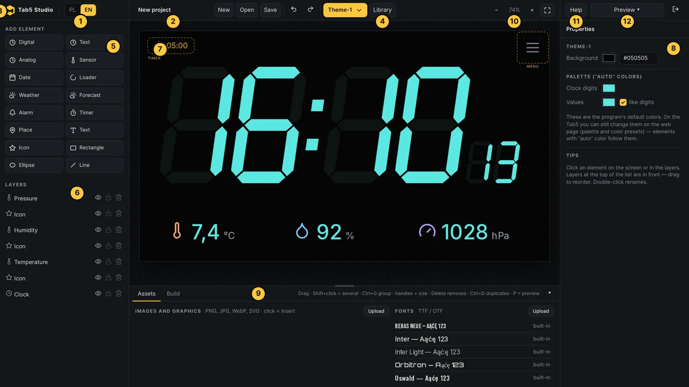
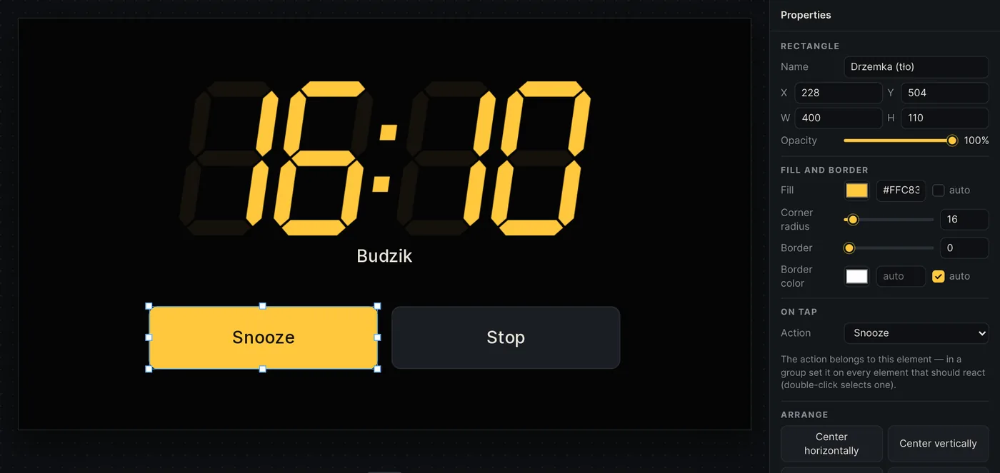
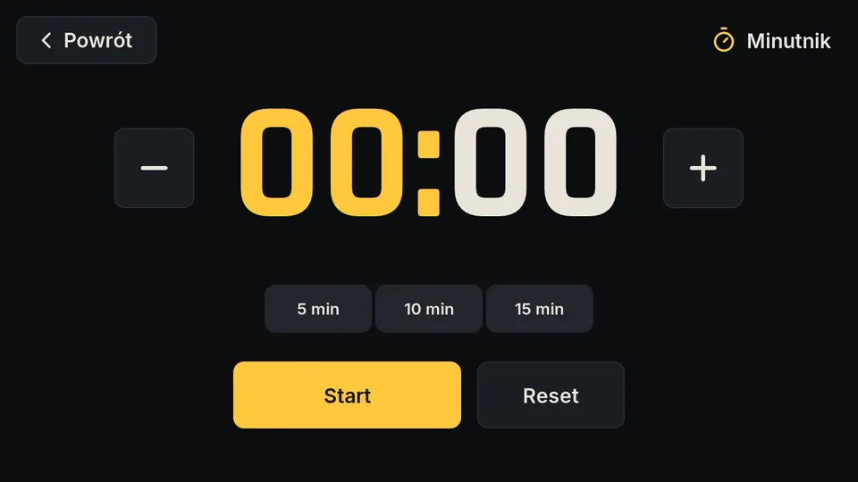
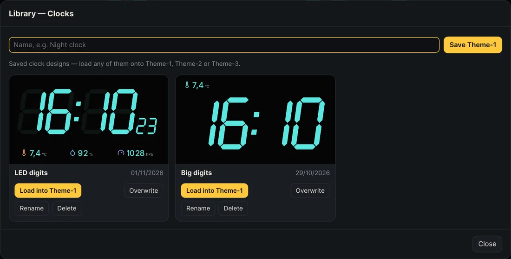
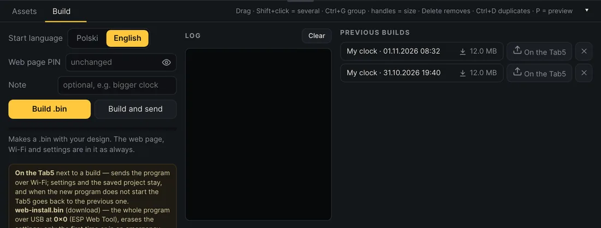

# Tab5 Studio

**[Wersja polska](README.md)** · Author: **Jakub W.**

A WYSIWYG editor for designing the clock on the **M5Stack Tab5**. You flash the Tab5 program once, then change the look from Studio with one click: **“Save to the Tab5 for good”**, no building. Tab5 Studio works in the browser and runs on your own server in Docker.

What you can design:
- **two clock themes and an optional third**: LED digits, a clock in a font or an analog dial, weather sensors and icons, a 7-day forecast, date, place, alarm and timer badges, texts, icons, images, shapes and loaders;
- the **intro** shown at start;
- the **alarm screen** and the **timer**, with any graphics as buttons (or the built-in ones: the time in LED digits, the timer in Rajdhani).

To start with: the first Studio start saves an **“Original Project”** with a ready look, including Theme-3 with the weather for a week. The weather works at once for Warsaw; you change the place on the Tab5 later.

How it works:
- **Preview → On the Tab5** sends the project to the Tab5 in your network to try it (the Preview button then turns yellow with LIVE);
- **Preview → Save to the Tab5 for good** saves the project in the Tab5 memory (about 6.8 MB after a USB flash of this version, 3.3 MB before). The Tab5 shows it after every start, and the project palette (the “auto” colors) goes to the Tab5 settings;
- a **`.bin` build** is needed only for the first flash and for updates of the program itself. Updates go over Wi-Fi. The Tab5 web page, Wi-Fi, alarms, timer and settings are in every build.



<table><tr>
<td width="50%"><br><sub>Your own alarm screen with tap actions</sub></td>
<td width="50%"><br><sub>The timer on the Tab5</sub></td>
</tr><tr>
<td><br><sub>Screen library</sub></td>
<td><br><sub>Building the .bin</sub></td>
</tr></table>

## What is in the repository

| Folder | Contents |
|---|---|
| `app/` | Tab5 Studio: server (Python, Flask) and editor (`app/static/index.html`) |
| `firmware/` | Tab5 firmware source (ESP-IDF 5.4, LVGL 9), without secrets |
| `docs/` | technical documentation: architecture, Studio, firmware, API |
| `mcp/` | optional MCP server: design screens by talking to Claude ([docs/MCP.md](docs/MCP.md)) |
| `scripts/` | `sync-firmware.sh` (copies the Tab5 source without secrets), `help_shots.js` and `web_shots.js` (help screenshots) |
| `CLAUDE.md` | notes for Claude Code: project rules and firmware pitfalls |
| `Dockerfile`, `docker-compose.yml`, `.env.example` | running it on a server |

## Running on a server (Docker)

You need Docker with Compose. The image is about 4 GB because it contains ESP-IDF.

```bash
git clone https://github.com/marcias1976/tab5studio.git
cd tab5studio
cp .env.example .env        # fill in: WIFI_SSID, WIFI_PASSWORD, WEB_PIN (4 digits), optionally STUDIO_PASSWORD
docker compose up -d --build
```

Studio is at `http://<server-address>:8080`. Set another port with `STUDIO_PORT` in `.env`.

- **The first build** takes a few minutes because it downloads ESP-IDF components. Later builds take about a minute.
- **Projects, the library, fonts, images and the built `.bin` files** are kept in the `data/` folder next to `docker-compose.yml`.
- **Set `STUDIO_PASSWORD`** if anyone besides you uses your network. Without it, anyone who reaches port 8080 has full access to Studio.
- **If Studio is reachable from outside your home**, set `STUDIO_PASSWORD` and put HTTPS in front of it, e.g. a reverse proxy.
- **The `.bin` files contain the Wi-Fi password and the web page PIN** in plain text. Do not share them.
- **The live preview** needs the server to reach the Tab5 in your network. A fixed IP for the Tab5 in your router helps.

### Security in short

Tab5 Studio and the Tab5 are meant for a home network:
- the Tab5 web page and API are protected by a 4-digit PIN, locked for 30 s after 5 wrong tries. Someone on your Wi-Fi could guess it in time, so keep strangers off your network;
- the Tab5 talks plain HTTP, without encryption; whoever knows the PIN can flash any program to it (no signing);
- import projects (`.tab5.zip`) only from sources you trust. Studio cleans them when loading, but it is your browser with access to Studio.

### The `.env` file

| Variable | Meaning |
|---|---|
| `STUDIO_PORT` | Studio's port on the server (default 8080) |
| `STUDIO_PASSWORD` | password for Studio (empty = none) |
| `ALLOWED_HOSTS` | only without a password: names Studio answers to (besides IP addresses and `localhost`), comma-separated. Other names are refused, which protects against DNS rebinding |
| `WIFI_SSID`, `WIFI_PASSWORD` | the Wi-Fi written into every build. The Tab5 adds it to its saved networks also when updated with `app.bin` |
| `WEB_PIN` | PIN of the Tab5 web page (4 digits); can be changed per build |
| `TAB5_HOST`, `TAB5_PIN` | Tab5 address and PIN for the live preview (can also be set in Studio) |

Secrets from `.env` only go into the built firmware. They are never sent to the browser.

## Flashing the Tab5

After a build, download one of two files from the “Build” tab:

- **`tab5panel-web-install.bin`**: the whole program from scratch over USB, at `0x0`, e.g. with ESP Web Tool in Chrome or Edge. Erases the settings and the saved project. Use it the first time.
- **Updates** go over Wi-Fi: with the **“On the Tab5”** button next to a build, or straight away with **“Build and send”**. Settings and the saved project stay, and when the new program does not start properly the Tab5 goes back to the previous one by itself. Before every update Studio backs up the Tab5 settings (without Wi-Fi passwords). (`tab5panel-app.bin` is the same program to download.)

After that you change the look without flashing: **Preview → Save to the Tab5 for good**. If the saved project ends in a restart three starts in a row, the Tab5 skips it and starts with the program's look. A frozen screen (15 s without drawing) restarts the Tab5 by itself, and Studio shows what blocked it.

The program version is the date and time of its build. It shows on the Tab5 (Menu → Other → Program version), on its web page and in Studio. Download a copy of the program now on the Tab5 from its web page (System tab → “Program backup”).

## Updating the Tab5 source in the repository

When you change the Tab5 code in a separate ESP-IDF project:

```bash
scripts/sync-firmware.sh ~/esp/tab5panel
docker compose up -d --build
```

The script does not copy `main/wifi_secrets.h` or `main/web_secrets.h`. It leaves `*.example` templates, and builds take the secrets from `.env`.

## Running without Docker (for testing)

You need ESP-IDF 5.4.2 and Python 3.10+.

```bash
python3 -m venv .venv && .venv/bin/pip install flask pillow fonttools
FIRMWARE_DIR=$PWD/firmware IDF_EXPORT=~/esp/esp-idf-v5.4.2/export.sh .venv/bin/python app/server.py
```

Without `.env`, copy `firmware/main/*_secrets.h.example` to `*_secrets.h` and fill them in.

## Designing with Claude (MCP, optional)

An optional MCP server (`mcp/tab5studio_mcp.py`, plain Python, no extra packages) lets you design screens by talking to Claude in Claude Code or Claude Desktop. You describe a screen; Claude builds it as a Studio project, sends it to the Tab5 as a live preview, looks at a screenshot of the Tab5 and fixes it. The Tab5 only gets an ordinary preview, so the firmware stays as it is. The server talks only to Studio and saves on the Tab5 only when you ask. It uses your own Claude account.

```bash
claude mcp add tab5studio -e STUDIO_URL=http://127.0.0.1:8080 -e STUDIO_PASSWORD='<Studio password>' \
  -- python3 "$PWD/mcp/tab5studio_mcp.py"
```

Claude Desktop setup and the list of tools: [docs/MCP.md](docs/MCP.md).

## Guide and documentation

- **The user guide** (PL / EN, with screenshots) is in Studio under the **“Help”** button or the `?` key. It has two tabs: **Tab5 Studio** and **Web Interface** (the Tab5 web page).
- **Server setup with Claude Code** (in Polish): [docs/SERVER-SETUP.md](docs/SERVER-SETUP.md).
- **Technical documentation** is in [`docs/`](docs/): [architecture](docs/ARCHITECTURE.md), [Studio](docs/STUDIO.md), [firmware](docs/FIRMWARE.md), [Tab5 API](docs/API.md), [MCP](docs/MCP.md).

## Author

**Jakub W.** (MARCIASMEDIA): idea, design and look of Tab5 Studio and the Tab5 firmware.

## License

Tab5 Studio and the Tab5 firmware: [MIT](LICENSE) © 2026 Jakub W. (MARCIASMEDIA). You may use, change and share the code, also commercially, keeping the author notice.

## Component licenses

- [ESP-IDF](https://github.com/espressif/esp-idf): Apache 2.0
- [LVGL](https://lvgl.io): MIT
- [esp_littlefs](https://github.com/joltwallet/esp_littlefs) (storage for the saved project): MIT
- Espressif components (esp_codec_dev and others): per their licenses
- in the repo: the M5Stack Tab5 BSP (`firmware/components/m5stack_tab5`), the `esp_lcd_st7121` display driver and `esp_lvgl_port` (changed, see its `MODIFICATIONS.md`): Apache 2.0, license texts in the component folders or the file headers
- [Lucide](https://lucide.dev) (icons): ISC, text in [licenses/](licenses/)
- Inter, Orbitron, Roboto Mono, Bebas Neue, Oswald, Rajdhani fonts: SIL Open Font License 1.1, texts in [licenses/](licenses/)
