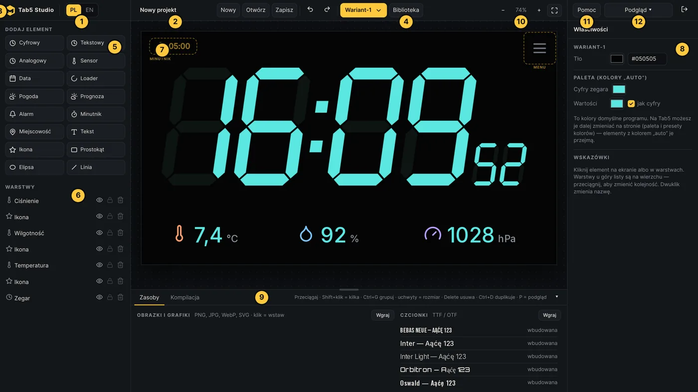
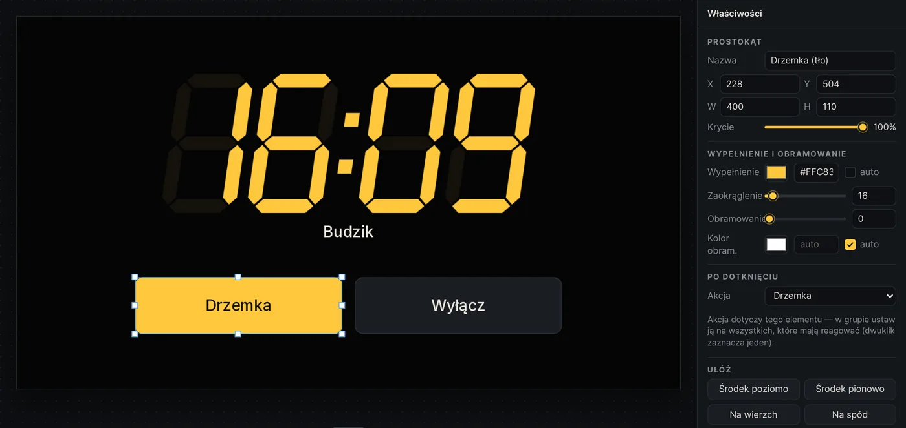
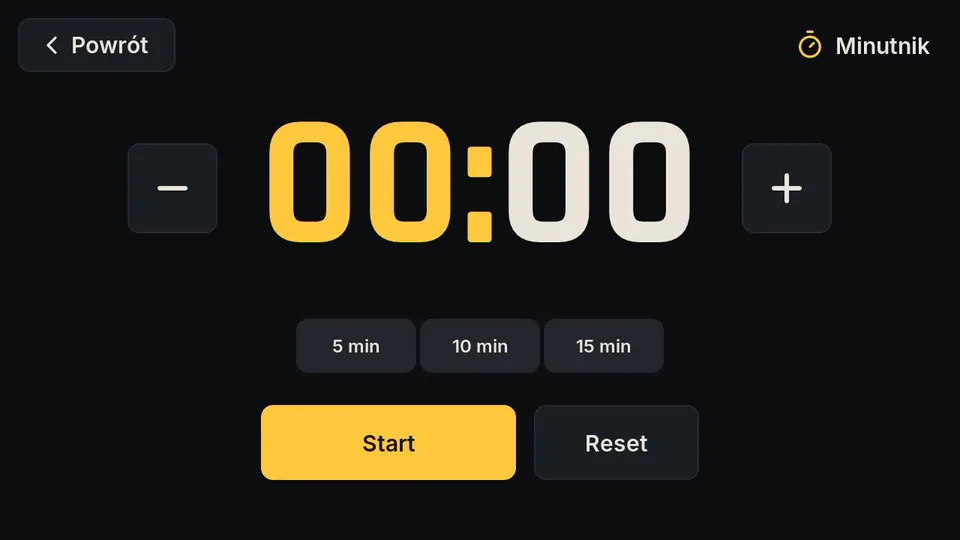
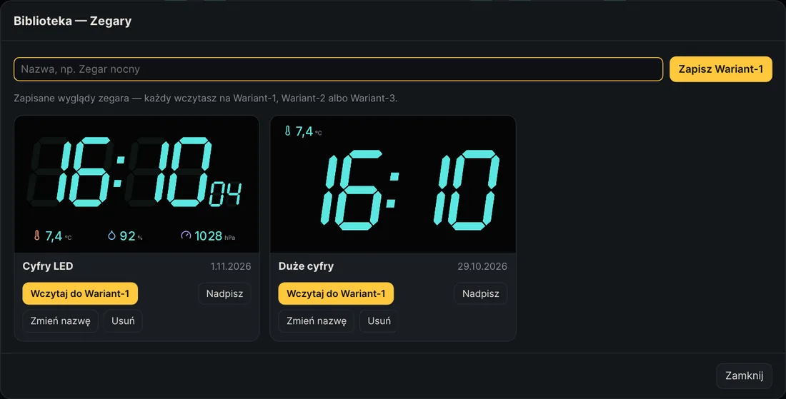
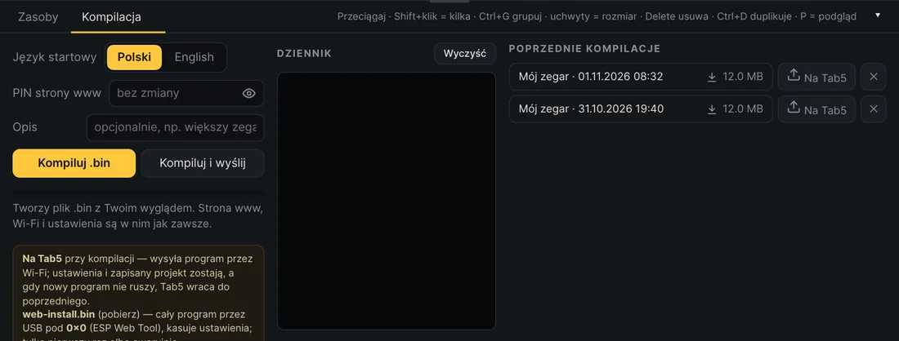

# Tab5 Studio

**[English version](README.en.md)** · Autor: **Jakub W.**

Edytor WYSIWYG do projektowania wyglądu zegara na **M5Stack Tab5**. Program wgrywasz na Tab5 raz, a potem wygląd zmieniasz w Studio jednym kliknięciem: **„Zapisz na Tab5 na stałe”**, bez kompilacji. Tab5 Studio działa w przeglądarce, a uruchamia się na Twoim serwerze w Dockerze.

Co zaprojektujesz:
- **dwa warianty zegara i opcjonalny trzeci**: cyfry LED, zegar czcionką albo tarcza analogowa, sensory i ikony pogody, prognoza na 7 dni, data, miejscowość, wskaźniki alarmu i minutnika, teksty, ikony, obrazki, kształty i loadery;
- **intro** wyświetlane przy starcie;
- **ekran alarmu** i **minutnik**, z dowolnymi grafikami jako przyciskami (albo wbudowane: godzina cyframi LED, minutnik fontem Rajdhani).

Na start: pierwsze uruchomienie Studio zapisuje **„Original Project”** z gotowym wyglądem, w tym Wariant-3 z prognozą na tydzień. Pogoda od razu działa dla Warszawy, a miejscowość zmieniasz potem na Tab5.

Jak to działa:
- **Podgląd → Na Tab5** wysyła projekt na Tab5 w Twojej sieci na próbę (przycisk Podgląd świeci wtedy na żółto z napisem LIVE);
- **Podgląd → Zapisz na Tab5 na stałe** zapisuje projekt w pamięci Tab5 (ok. 6,8 MB po wgraniu przez USB tej wersji, wcześniej 3,3 MB). Tab5 pokazuje go po każdym starcie, a paleta projektu (kolory „auto”) trafia przy tym do ustawień Tab5;
- **kompilacja** `.bin` jest potrzebna tylko do pierwszego wgrania i do aktualizacji samego programu. Aktualizacje idą przez Wi-Fi. Strona www Tab5, Wi-Fi, budzik, minutnik i ustawienia są w każdym programie.



<table><tr>
<td width="50%"><br><sub>Własny ekran alarmu z akcjami po dotknięciu</sub></td>
<td width="50%"><br><sub>Minutnik na Tab5</sub></td>
</tr><tr>
<td><br><sub>Biblioteka ekranów</sub></td>
<td><br><sub>Kompilacja .bin</sub></td>
</tr></table>

## Co jest w repozytorium

| Folder | Zawartość |
|---|---|
| `app/` | Tab5 Studio: serwer (Python, Flask) i edytor (`app/static/index.html`) |
| `firmware/` | kod programu Tab5 (ESP-IDF 5.4, LVGL 9), bez haseł |
| `docs/` | dokumentacja techniczna: architektura, Studio, firmware, API |
| `scripts/` | `sync-firmware.sh` (kopiuje kod Tab5 bez haseł), `help_shots.js` i `web_shots.js` (zrzuty do Pomocy) |
| `CLAUDE.md` | skrót dla Claude Code: zasady projektu i pułapki firmware |
| `Dockerfile`, `docker-compose.yml`, `.env.example` | uruchomienie na serwerze |

## Uruchomienie na serwerze (Docker)

Potrzebujesz Dockera z Compose. Obraz ma ok. 4 GB, bo zawiera ESP-IDF.

```bash
git clone https://github.com/marcias1976/tab5studio.git
cd tab5studio
cp .env.example .env        # uzupełnij: WIFI_SSID, WIFI_PASSWORD, WEB_PIN (4 cyfry), opcjonalnie STUDIO_PASSWORD
docker compose up -d --build
```

Studio jest pod adresem `http://<adres-serwera>:8080`. Inny port ustawisz w `.env` zmienną `STUDIO_PORT`.

- **Pierwsza kompilacja** trwa kilka minut, bo pobiera komponenty ESP-IDF. Kolejne trwają ok. minuty.
- **Projekty, biblioteka, czcionki, obrazki i gotowe pliki `.bin`** są zapisywane w folderze `data/` obok `docker-compose.yml`.
- **Ustaw `STUDIO_PASSWORD`**, jeśli z sieci korzysta ktoś poza Tobą. Bez hasła każdy, kto dosięgnie portu 8080, ma pełny dostęp do Studio.
- **Jeśli Studio ma być dostępne spoza domu**, ustaw `STUDIO_PASSWORD` i postaw przed nim HTTPS, np. reverse proxy.
- **Pliki `.bin` zawierają hasło Wi-Fi i PIN strony www** zapisane jawnym tekstem. Nie udostępniaj ich innym.
- **Podgląd na żywo** wymaga, żeby serwer widział Tab5 w sieci. Najlepiej ustaw Tab5 stały adres IP w routerze.

### Bezpieczeństwo w skrócie

Tab5 Studio i Tab5 są pomyślane do domowej sieci lokalnej:
- strona www i API Tab5 chroni 4-cyfrowy PIN, po 5 złych próbach blokada na 30 s. Ktoś w Twojej sieci Wi-Fi może go z czasem odgadnąć, więc nie wpuszczaj do niej obcych;
- komunikacja z Tab5 to zwykłe HTTP, bez szyfrowania; kto zna PIN, może wgrać na Tab5 dowolny program (bez podpisu);
- importuj projekty (`.tab5.zip`) tylko z zaufanych źródeł. Studio czyści je przy wczytaniu, ale to Twoja przeglądarka z dostępem do Studio.

### Plik `.env`

| Zmienna | Znaczenie |
|---|---|
| `STUDIO_PORT` | port Studio na serwerze (domyślnie 8080) |
| `STUDIO_PASSWORD` | hasło do Studio (puste = bez hasła) |
| `ALLOWED_HOSTS` | tylko bez hasła: nazwy, pod którymi Studio odpowiada (oprócz adresów IP i `localhost`), po przecinku. Inne nazwy są odrzucane, co chroni przed atakiem DNS rebinding |
| `WIFI_SSID`, `WIFI_PASSWORD` | sieć Wi-Fi wpisywana do każdego programu. Tab5 dopisuje ją do zapisanych sieci także przy aktualizacji przez `app.bin` |
| `WEB_PIN` | PIN strony www Tab5 (4 cyfry); można go zmienić przy kompilacji |
| `TAB5_HOST`, `TAB5_PIN` | adres i PIN Tab5 do podglądu na żywo (można je też ustawić w Studio) |

Hasła z `.env` trafiają tylko do kompilowanego programu i nie są przesyłane do przeglądarki.

## Wgrywanie programu na Tab5

Po kompilacji w zakładce „Kompilacja” pobierasz jeden z dwóch plików:

- **`tab5panel-web-install.bin`**: cały program od zera przez USB, pod adres `0x0`, np. przez ESP Web Tool w Chrome albo Edge. Kasuje ustawienia i zapisany projekt. Użyj go za pierwszym razem.
- **Aktualizacje** wysyłasz przez Wi-Fi: przyciskiem **„Na Tab5”** przy kompilacji albo od razu **„Kompiluj i wyślij”**. Ustawienia i zapisany projekt zostają, a gdy nowy program nie uruchomi się poprawnie, Tab5 sam wraca do poprzedniego. Przed każdą aktualizacją Studio robi kopię ustawień Tab5 (bez haseł Wi-Fi). (`tab5panel-app.bin` to ten sam program do pobrania.)

Potem wygląd zmieniasz już bez wgrywania: **Podgląd → Zapisz na Tab5 na stałe**. Gdyby zapisany projekt trzy razy z rzędu zakończył się restartem, Tab5 go pominie i uruchomi się z wyglądem z programu. Zamrożony ekran (15 s bez odświeżania) Tab5 restartuje sam, a Studio pokazuje, co go zablokowało.

Wersja programu to data i godzina kompilacji. Widać ją na Tab5 (Menu → Inne → Wersja programu), na jego stronie www i w Studio. Kopię programu, który jest teraz na Tab5, pobierzesz z jego strony www (zakładka System → „Kopia programu”).

## Aktualizacja kodu Tab5 w repozytorium

Gdy zmienisz kod Tab5 w osobnym projekcie ESP-IDF:

```bash
scripts/sync-firmware.sh ~/esp/tab5panel
docker compose up -d --build
```

Skrypt nie kopiuje plików `main/wifi_secrets.h` ani `main/web_secrets.h`. Zostawia wzory `*.example`, a hasła do kompilacji bierze z `.env`.

## Uruchomienie bez Dockera (do testów)

Potrzebujesz ESP-IDF 5.4.2 i Pythona 3.10+.

```bash
python3 -m venv .venv && .venv/bin/pip install flask pillow fonttools
FIRMWARE_DIR=$PWD/firmware IDF_EXPORT=~/esp/esp-idf-v5.4.2/export.sh .venv/bin/python app/server.py
```

Bez `.env` skopiuj `firmware/main/*_secrets.h.example` na `*_secrets.h` i uzupełnij je.

## Instrukcja i dokumentacja

- **Instrukcja dla użytkownika** (PL / EN, ze zrzutami) jest w Studio pod przyciskiem **„Pomoc”** albo klawiszem `?`. Ma dwie zakładki: **Tab5 Studio** i **Web Interface** (strona www Tab5).
- **Uruchomienie na serwerze z pomocą Claude Code:** [docs/SERVER-SETUP.md](docs/SERVER-SETUP.md).
- **Dokumentacja techniczna** jest w folderze [`docs/`](docs/): [architektura](docs/ARCHITECTURE.md), [Studio](docs/STUDIO.md), [firmware](docs/FIRMWARE.md), [API Tab5](docs/API.md).

## Autor

**Jakub W.** (MARCIASMEDIA): pomysł, projekt i wygląd Tab5 Studio oraz programu Tab5.

## Licencja

Tab5 Studio i program Tab5: [MIT](LICENSE) © 2026 Jakub W. (MARCIASMEDIA). Możesz używać, zmieniać i rozpowszechniać kod, także komercyjnie, zachowując informację o autorze.

## Licencje komponentów

- [ESP-IDF](https://github.com/espressif/esp-idf): Apache 2.0
- [LVGL](https://lvgl.io): MIT
- [esp_littlefs](https://github.com/joltwallet/esp_littlefs) (pamięć na zapisany projekt): MIT
- komponenty Espressif (esp_codec_dev i inne): zgodnie z ich licencjami
- w repozytorium: BSP M5Stack Tab5 (`firmware/components/m5stack_tab5`), sterownik ekranu `esp_lcd_st7121` i `esp_lvgl_port` (zmieniony, lista zmian w `MODIFICATIONS.md`): Apache 2.0, teksty licencji w katalogach komponentów albo w nagłówkach plików
- [Lucide](https://lucide.dev) (ikony): ISC, tekst w [licenses/](licenses/)
- czcionki Inter, Orbitron, Roboto Mono, Bebas Neue, Oswald, Rajdhani: SIL Open Font License 1.1, teksty w [licenses/](licenses/)
